# Awesome White-Label Portal Customization 🚀

  

  
  
  
  

> 🌟 **A curated directory of top White-Label Portal Customization platforms** — featuring commercial SaaS solutions, self-hosted open-source software, client dashboards, branded document-sharing hubs, and client collaboration portals.
>
> Whether you run a digital marketing agency, consultancy, MSP, accounting firm, or enterprise product team, this guide helps you find the right white-label portal software to elevate your client experience.

---

## 📑 Table of Contents

- [🌐 Sector Overview & Market Dynamics](#-sector-overview--market-dynamics)
- [🏢 SaaS / Hosted Platforms](#-saas--hosted-platforms)
  - [SaaS Platforms Comparison Table](#-saas-platforms-comparison-table)
  - [Detailed SaaS Profiles](#-detailed-saas-profiles)
- [🔓 Open-Source Software](#-open-source-software)
  - [Open-Source Solutions Comparison](#-open-source-solutions-comparison)
  - [Detailed Open-Source Profiles](#-detailed-open-source-profiles)
- [📊 Feature Matrix & Architectural Overview](#-feature-matrix--architectural-overview)
- [🔍 Key Selection Criteria for White-Label Portals](#-key-selection-criteria-for-white-label-portals)
- [🤝 Contributing](#-contributing)
- [📄 License](#-license)

---

## 🌐 Sector Overview & Market Dynamics

The global client portal and digital client experience software market is currently valued at approximately **$2.5 billion to $3.5 billion**, with projections forecasting it to reach **$8.5 billion+ by 2032** at a robust Compound Annual Growth Rate (CAGR) of **8.5% to 11%**.

The sector exhibits **moderate-to-high fragmentation** at the lower and mid-market tiers—fueled by hundreds of specialized, niche vertical solutions tailored for agencies, law firms, and accounting practices—while simultaneously facing **concentrated ecosystem gravity** at the upper enterprise level where heavyweight CRM and cloud platforms (Salesforce Experience Cloud, Microsoft Power Pages, ServiceNow) dominate mission-critical enterprise workflows.

---

## 🏢 SaaS / Hosted Platforms

Commercial, cloud-hosted white-label client portal platforms offering branded web domains, custom CSS/theming, secure document management, client onboarding, invoicing, and messaging.

### 📊 SaaS Platforms Comparison Table

*The table below is ordered by estimated company scale (Revenue / Valuation) in descending order:*

| Platform 🏷️ | Scale (Valuation / Revenue) 📈 | Starting Pricing 💰 | Free Tier / Trial Limit ⏱️ | White-Label Customization Depth 🎨 | Primary Focus & Target Audience 🎯 |
|---|---|---|---|---|---|
| **[Chargebee](https://www.chargebee.com)** | **$3.5B Valuation** (~$150M+ ARR) | $599/mo (Rise plan for custom domain portal) | **Starter Free Tier**: Free up to first $250k lifetime billing (Sandbox trial available) | Custom domain CNAME mapping for checkout & billing self-service pages | Subscription billing management & customer invoice portal |
| **[Moxo](https://www.moxo.com)** | **~$26M ARR** ($80M+ Funding) | ~$200/mo (Business tier) | **Free Trial on request / demo** (Evaluates custom portal workspaces) | Custom branding, domain mapping, white-label client mobile apps | Workflow automation, secure messaging, client approval gates |
| **[Softr](https://www.softr.io)** | **$15.7M+ Funding** (~$5M+ ARR) | $19/mo (billed annually) / $25/mo (monthly) | **Free Forever Plan**: 5 internal/external app users, 5k records, Softr subdomain & branding | Complete drag-and-drop visual builder, custom domain, CSS styling | No-code web app & portal builder powered by Airtable / Google Sheets / SQL |
| **[ClientPoint](https://www.clientpoint.net)** | **~$6.3M ARR** (Enterprise-backed) | ~$83/user/mo (Enterprise quote-based) | **Demo-based provisioned trial** (Guided sandbox instance) | Full white-label custom virtual workspaces, custom vanity URLs | Enterprise relationship workspace, deals, scheduling, and proposals |
| **[SuiteDash](https://suitedash.com)** | **~$5.6M ARR** (Bootstrapped / Profitable) | $19/mo (Start) / $49/mo (Thrive) / $99/mo (Pinnacle) | **14-day Free Trial** (Full access to Pinnacle tier, unlimited users, no credit card) | Complete white-labeling: Custom URL, white-label email, portal branding | All-in-one business management, CRM, invoicing, agency client portal |
| **[Assembly (Copilot)](https://www.copilot.com)** | **~$4.1M ARR** (Venture-backed) | $149/mo (Standard tier, 3 seats, 500 clients) | **14-day Free Trial** (Includes core client portal apps, no credit card) | Custom domain, custom logo, theme styling, client notifications | Modern client portal for service firms, design agencies, consultancies |
| **[Clinked](https://www.clinked.com)** | **~$2.5M ARR** (Established SME SaaS) | $77/mo (Lite plan, billed annually) | **10-day Free Trial** (Full portal feature set, no credit card required) | Full white-label branding, custom domain, branded iOS/Android apps | High-security document sharing, M&A, legal, accounting collaboration |
| **[Onehub](https://www.onehub.com)** | **~$1.5M ARR** (Profitable boutique) | $12.50/user/mo (Standard, billed annually; 3 users min) | **14-day Free Trial** (1TB storage, up to 200 users, full preview features) | Custom brand logo, accent colors, personalized domain URL | Secure branded file exchange, virtual data rooms (VDR), document collaboration |
| **[MyDocSafe](https://www.mydocsafe.com)** | **~$0.6M ARR** (Lean European SaaS) | £18/user/mo (~$23/user/mo, Business Pro) | **30-day Free Trial** (Up to 20 e-signatures, client portal setup, no credit card) | Custom domain, custom favicon, branded mobile app deployment | Regulated document onboarding, electronic signatures, compliance forms |

---

### 🔍 Detailed SaaS Profiles

#### 💳 Chargebee Portal Customization
* **Core Specialty:** Subscription billing and recurring payment portal white-labeling.
* **White-Labeling Features:** Enables custom domain mapping via CNAME to eliminate Chargebee vendor URLs on client billing portals and checkout pages.
* **Best Suited For:** SaaS and subscription commerce companies wanting a branded billing, invoice download, and payment method update portal.

#### 🤝 Moxo
* **Core Specialty:** High-touch digital interaction workflows and secure client workspaces.
* **White-Labeling Features:** End-to-end white-labeling across web and native iOS/Android mobile apps with custom enterprise domain mapping.
* **Best Suited For:** Financial institutions, legal advisors, accounting firms, and consulting organizations running complex multi-step client journeys.

#### 🧩 Softr
* **Core Specialty:** Modular, no-code web portal builder connected to relational databases.
* **White-Labeling Features:** Full visual theming, custom design tokens, personalized domain, custom user permissions, and custom code injection.
* **Best Suited For:** Teams wanting to build bespoke client portals, member directories, and partner dashboards on top of Airtable, Google Sheets, or Postgres.

#### 💼 ClientPoint
* **Core Specialty:** Collaborative business relationship workspaces and deal rooms.
* **White-Labeling Features:** Curated corporate brand environments, custom enterprise domains, and branded document viewers.
* **Best Suited For:** Enterprise sales, account management, and client onboarding teams needing proposals, meetings, and signatures in one branded space.

#### 🛠️ SuiteDash
* **Core Specialty:** Comprehensive, all-in-one business portal suite with unlimited client seats.
* **White-Labeling Features:** Deep multi-level presentation layer covering custom domain login, platform colors, logos, and custom SMTP email delivery.
* **Best Suited For:** Digital marketing agencies and independent service businesses that need CRM, project management, invoicing, and client portals in a single tool.

#### 🚀 Assembly (formerly Copilot)
* **Core Specialty:** Modern, app-driven client portal platform for professional services.
* **White-Labeling Features:** Sleek branded login, custom client dashboards, modular in-portal micro-apps (Files, Invoices, Messages, Forms), and custom domains.
* **Best Suited For:** Modern creative agencies, growth consultancies, and digital firms seeking an exceptional out-of-the-box client experience.

#### 🔒 Clinked
* **Core Specialty:** Enterprise-grade secure collaboration and virtual data room spaces.
* **White-Labeling Features:** Custom domain, brand colors, custom login dialog, and dedicated branded iOS & Android apps in app stores.
* **Best Suited For:** Regulated industries, corporate finance, legal teams, and accounting practices handling sensitive client documentation.

#### 📁 Onehub
* **Core Specialty:** Cloud-hosted virtual data rooms and branded file-sharing hubs.
* **White-Labeling Features:** Custom logo integration, custom color schemes, custom subdomains, and branded client upload portals.
* **Best Suited For:** Teams that need rock-solid, bank-level encrypted file sharing with precise role-based permissions without enterprise bloat.

#### 📝 MyDocSafe
* **Core Specialty:** Document onboarding, compliance document collection, and electronic signatures.
* **White-Labeling Features:** Custom domain URL, custom favicon, custom branding, and whitelabeled mobile apps.
* **Best Suited For:** Legal and accounting practices requiring KYC/AML compliance, secure client intake, and client onboarding automation.

---

## 🔓 Open-Source Software

Self-hosted, community-driven client portal platforms offering complete code ownership, zero vendor lock-in, customizable architecture, and flexible on-premise or private cloud deployments.

### 🌟 Open-Source Solutions Comparison

*The table below is sorted by GitHub star count in descending order:*

| Repository 📦 | GitHub Stars 🌟 | Primary Stack 💻 | License 📜 | Deployment 🐳 | Key Highlights 💡 |
|---|---|---|---|---|---|
| **[projectsend/projectsend](https://github.com/projectsend/projectsend)** |  | PHP / MySQL / Bootstrap | GPL-2.0 | Docker / LAMP Stack | Mature self-hosted file sharing client portal with fine-grained access control and custom branding |
| **[itflow-org/itflow](https://github.com/itflow-org/itflow)** |  | PHP / MariaDB / Tailwind CSS | GPL-3.0 | Docker / Web Server | All-in-one MSP & IT client portal covering ticketing, invoicing, password sharing, and asset tracking |
| **[Panelica/pnlcs](https://github.com/Panelica/pnlcs)** |  | PHP (Laravel 13) / MySQL | MIT | Docker / Composer | Modern WHMCS alternative with self-hosted hosting billing, client portal, ticketing, and 16 themes |
| **[Vibra-Labs/Atrium](https://github.com/Vibra-Labs/Atrium)** |  | TypeScript (Next.js / NestJS) / PostgreSQL | AGPL-3.0 | Docker Compose / Bun | Dedicated modern client portal for freelancers & agencies featuring project tracking, discussions, and file sharing |
| **[FlowEngine-cloud/flowengine](https://github.com/FlowEngine-cloud/flowengine)** |  | TypeScript (Next.js) / Docker | Apache-2.0 | Docker / Cloud | White-label client portal built for automation agencies to manage client workflow instances and Stripe billing |
| **[pixelcop/clientshare](https://github.com/pixelcop/clientshare)** |  | Go / Vue 3 / SQLite / PostgreSQL | MIT | Docker Compose (Single binary) | Minimalist, single-binary branded client file portal with expiring links, custom logo, and S3 support |

---

### 📖 Detailed Open-Source Profiles

#### 🗄️ [ProjectSend](https://github.com/projectsend/projectsend)
* **Stack:** PHP, MySQL, JavaScript, Bootstrap
* **License:** GNU General Public License v2.0
* **Overview:** A battle-tested open-source software project that allows businesses to upload and share files securely with clients. Clients log in to their private portal where they only see documents, presentations, and contracts assigned specifically to them.
* **White-Labeling Features:** Custom logos, customizable templates, email notification templates, and organization themes.

#### 🧰 [ITFlow](https://github.com/itflow-org/itflow)
* **Stack:** PHP, MariaDB, Bootstrap, Tailwind CSS
* **License:** GNU General Public License v3.0
* **Overview:** Designed specifically for Managed Service Providers (MSPs), IT agencies, and technology consultants. Offers a comprehensive client portal where clients can submit support tickets, view project progress, pay invoices, and securely share credentials.
* **White-Labeling Features:** Company branding, customizable client view, custom domain, and company portal themes.

#### ⚡ [Panelica (pnlcs)](https://github.com/Panelica/pnlcs)
* **Stack:** Laravel 13, MySQL, Tailwind CSS, Alpine.js
* **License:** MIT License
* **Overview:** A lightweight, self-hosted WHMCS alternative engineered for digital agencies, hosting resellers, and cloud service providers. Combines subscription invoicing, domain provisioning, and client support in an intuitive interface.
* **White-Labeling Features:** 16 pre-built client portal themes, custom locale translations (30 languages), custom logos, and customizable email templates.

#### 🏛️ [Atrium](https://github.com/Vibra-Labs/Atrium)
* **Stack:** Next.js, NestJS, Prisma, PostgreSQL, Docker
* **License:** GNU Affero General Public License v3.0
* **Overview:** Built from the ground up to solve agency clutter. Replaces scattered Slack messages, Google Drive links, and Trello boards with a unified, branded client workspace. Features Kanban milestones, asset management, and invoice generators.
* **White-Labeling Features:** Custom organization logos, branded color tokens, custom client login page, and custom email notifications.

#### 🤖 [FlowEngine](https://github.com/FlowEngine-cloud/flowengine)
* **Stack:** Next.js, TypeScript, Docker, Stripe API
* **License:** Apache License 2.0
* **Overview:** Tailored for AI and workflow automation agencies (managing n8n, Make, or custom LLM bots). Gives clients an executive dashboard to monitor workflow executions, trigger automations, and manage subscription billing.
* **White-Labeling Features:** Full client portal white-labeling, custom agency logo, branded login screens, and custom domain configuration.

#### 📦 [ClientShare](https://github.com/pixelcop/clientshare)
* **Stack:** Go, Vue 3, SQLite / PostgreSQL
* **License:** MIT License
* **Overview:** An ultra-lightweight client file exchange solution delivered as a single compiled Go binary with an embedded Vue frontend. Minimal memory footprint, zero dependencies, and instant Docker deployment.
* **White-Labeling Features:** Site title customization, primary theme color selection, and custom brand logo upload.

---

## 📊 Feature Matrix & Architectural Overview

The table below contrasts the technical architecture, operational requirements, and branding depth of each option:

| Solution 🛠️ | Architectural Model 🏗️ | White-Label Depth 🎨 | Deployment Target ☁️ | Ideal Business Size 👥 |
|---|---|---|---|---|
| **Chargebee** | Hosted Multi-Tenant SaaS | Custom Domain & Hosted Pages | Cloud (Chargebee CDN) | Mid-Market to Enterprise |
| **Moxo** | Hosted SaaS / Enterprise Private Cloud | Web + Full Native Mobile Apps | Cloud / Dedicated VPC | Mid-Market to Enterprise |
| **Softr** | Hosted No-Code PaaS | Deep Visual Theming & CSS | Softr Cloud Infrastructure | Solopreneurs to Mid-Market |
| **ClientPoint** | Hosted SaaS | Custom Corporate Brand Workspace | Enterprise Cloud | Enterprise Service Providers |
| **SuiteDash** | Hosted SaaS | Full Platform + Custom SMTP + Vanity URLs | SuiteDash Cloud | Agencies & Freelancers |
| **Assembly (Copilot)** | Hosted SaaS | Custom Domain + Modular App Portal | Copilot Cloud | Agencies & Boutiques |
| **Clinked** | Hosted SaaS | Custom URL + Branded App Store Apps | Clinked Cloud / Private Cloud | Regulated SMBs & Mid-Market |
| **Onehub** | Hosted SaaS | Custom Subdomain + Logo & Brand Palette | AWS Cloud | Small Teams to Enterprises |
| **MyDocSafe** | Hosted SaaS | Custom Favicon + Vanity URL + Mobile | EU/US Cloud | Legal & Accounting Boutiques |
| **ProjectSend** | Self-Hosted Open Source | Custom Assets + Templating System | Linux / Docker / cPanel | Freelancers & Small Agencies |
| **ITFlow** | Self-Hosted Open Source | Portal Customization & Custom Logos | Docker / VPS | MSPs & IT Consultancies |
| **Panelica** | Self-Hosted Open Source | 16 Themes + Custom Blade Views | Docker / VPS / Shared Host | Web Hosts & Digital Agencies |
| **Atrium** | Self-Hosted Open Source | Agency Accent Colors & Custom Logo | Docker Compose / VPS | Modern Design & Dev Agencies |
| **FlowEngine** | Self-Hosted Open Source | Full Whitelabel Portal UI | Docker / Cloud Run | AI & Automation Agencies |
| **ClientShare** | Self-Hosted Open Source | Basic Branding (Logo, Title, Accent) | Single Docker Container | Freelancers & Lean Teams |

---

## 🔍 Key Selection Criteria for White-Label Portals

When evaluating a white-label client portal for your business, consider the following technical and functional factors:

1. **Branding Depth & Custom Domains 🌐**: Verify whether the software supports full CNAME custom domain mapping with automated SSL provisioning (e.g., `portal.youragency.com`) and white-label email notifications (custom SMTP).
2. **Mobile Experience & Native Apps 📱**: Determine if your clients require dedicated mobile apps in the App Store / Google Play (e.g., Clinked, Moxo) or if a responsive Progressive Web App (PWA) suffices (e.g., Softr, Atrium).
3. **Data Security & Regulatory Compliance 🔐**: Regulated industries (legal, healthcare, accounting, fintech) require SOC 2 Type II compliance, HIPAA BAA agreements, GDPR compliance, and end-to-end encryption at rest and in transit.
4. **Client Collaboration vs. File Sharing 📂**: Choose between pure-play file exchange tools (Onehub, ProjectSend, ClientShare) and full-lifecycle business suites featuring tasks, e-signatures, and invoicing (SuiteDash, Assembly, Moxo).
5. **Total Cost of Ownership (TCO) 💵**: Balance predictable flat-rate pricing (SuiteDash, self-hosted open-source) against per-user or seat-based licensing models as your client volume scales.

---

## 🤝 Contributing

Contributions are warmly welcomed! Help make this curated directory the definitive guide for white-label client portals.

To add a tool:
1. Fork this repository 🍴
2. Create a new branch: `git checkout -b feature/add-new-portal`
3. Add the project under the appropriate section with stack, pricing/license, and key white-label features
4. Submit a Pull Request with a clear description 🚀

*Please ensure submitted open-source projects are actively maintained and provide clear documentation.*

---

## 📄 License

This repository and its curated contents are dedicated to the public domain under the [Creative Commons Zero v1.0 Universal](LICENSE) (CC0 1.0).

---

  ⭐ <b>Found this resource valuable? Don't forget to star the repository!</b> ⭐

